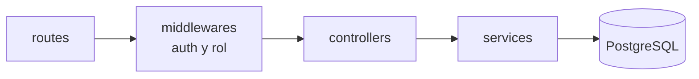

# API REST

Base: `http://localhost:3001/api` (el puerto se cambia con `PORT` en `.env`). Todas las respuestas son JSON, salvo las que devuelven 204 (sin contenido).

## Autenticación

El login devuelve un token JWT. En el resto de las peticiones se envía en el encabezado:

```
Authorization: Bearer <token>
```

Sin token, o con un token vencido o inválido, la API responde 401.

## Endpoints

| Método | Ruta | Acceso | Qué hace | Respuestas |
|---|---|---|---|---|
| POST | `/api/auth/login` | Público | Valida correo y contraseña. Devuelve el token y los datos del usuario | 200, 400, 401 |
| GET | `/api/auth/perfil` | Con sesión | Datos del usuario de la sesión. El frontend lo usa al recargar la página | 200, 401 |
| GET | `/api/salud` | Público | Comprueba que la API responde | 200 |
| GET | `/api/categorias` | Con sesión | Lista las categorías con su color | 200 |
| GET | `/api/puntos` | Con sesión | Todos los puntos con categoría y usuario. Filtros `?categoriaId=` y `?q=` | 200 |
| GET | `/api/puntos/:id` | Con sesión | Un punto | 200, 404 |
| POST | `/api/puntos` | Con sesión | Crea un punto. `usuario_id` sale del token | 201, 400 |
| PUT | `/api/puntos/:id` | Con sesión | Actualiza un punto | 200, 400, 404 |
| DELETE | `/api/puntos/:id` | Con sesión | Elimina un punto | 204, 404 |
| GET | `/api/usuarios` | Admin | Lista de usuarios, sin `password_hash` | 200, 403 |
| POST | `/api/usuarios` | Admin | Crea un usuario | 201, 400, 409 |
| PUT | `/api/usuarios/:id` | Admin | Actualiza datos, rol, estado o contraseña | 200, 400, 404, 409 |
| DELETE | `/api/usuarios/:id` | Admin | Elimina un usuario y sus puntos. No puede eliminarse a sí mismo | 204, 400, 404 |

## Códigos HTTP

| Código | Cuándo |
|---|---|
| 200 | Consulta o actualización correcta |
| 201 | Registro creado |
| 204 | Eliminado, sin contenido que devolver |
| 400 | Datos inválidos. El cuerpo trae `{ "errores": [ ... ] }` |
| 401 | Sin token, token vencido o credenciales incorrectas |
| 403 | La ruta exige rol de administrador |
| 404 | El registro no existe |
| 409 | Conflicto, por ejemplo un correo repetido |

## Ejemplos

### Login

```http
POST /api/auth/login
Content-Type: application/json

{ "correo": "ana.lopez@empresa.com", "password": "********" }
```

```json
200 OK
{
  "token": "eyJhbGciOi...",
  "usuario": { "id": 1, "nombre": "Ana López", "rol": "ADMIN" }
}
```

### Respuestas de autenticación

| Situación | Código | Cuerpo |
|---|:---:|---|
| Correo o contraseña incorrectos, o correo inexistente | 401 | `{ "mensaje": "Correo o contraseña incorrectos" }` |
| Contraseña correcta pero cuenta inactiva | 401 | `{ "mensaje": "Tu cuenta está inactiva. Contacta a un administrador" }` |
| Faltan campos o el correo no es válido | 400 | `{ "errores": [ ... ] }` |
| Sin token | 401 | `{ "mensaje": "Se requiere iniciar sesión" }` |
| Token inválido | 401 | `{ "mensaje": "Token inválido" }` |
| Token vencido | 401 | `{ "mensaje": "La sesión expiró, inicia sesión de nuevo" }` |
| Usuario eliminado o desactivado con un token vigente | 401 | `{ "mensaje": "La sesión ya no es válida" }` |
| Rol insuficiente | 403 | `{ "mensaje": "No tienes permiso para esta acción" }` |

El mensaje de cuenta inactiva solo se muestra cuando la contraseña es correcta. Así nadie puede averiguar qué cuentas existen probando contraseñas al azar.

### Crear un punto

```http
POST /api/puntos
Authorization: Bearer <token>
Content-Type: application/json

{
  "nombre": "Oficina Centro",
  "descripcion": "Oficina principal",
  "latitud": 19.432608,
  "longitud": -99.133209,
  "categoriaId": 1
}
```

### Error de validación

```json
400 Bad Request
{
  "errores": [
    "La longitud debe estar entre -180 y 180",
    "El nombre debe tener entre 3 y 100 caracteres"
  ]
}
```

## Reglas generales

- El middleware de autenticación revisa el token en todas las rutas, excepto el login y `/api/salud`. Además consulta al usuario en la base en cada petición (ver D-10).
- El middleware de rol bloquea `/api/usuarios` con 403 si el usuario no es administrador.
- Un usuario inactivo no puede iniciar sesión.
- La API nunca devuelve `password_hash`.
- CORS está habilitado para el origen del frontend, que se configura en `.env`.
- La conexión a la base de datos y la llave del JWT se toman de `.env`.
- Todas las consultas SQL son parametrizadas.

## Estructura del backend



Las rutas reciben la petición, los middlewares la validan, los controladores responden y los servicios hablan con la base de datos.

Carpetas dentro de `backend/src`:

| Carpeta | Contenido |
|---|---|
| `config/` | Variables de entorno validadas y conexión a PostgreSQL |
| `routes/` | Definición de rutas |
| `controllers/` | Reciben la petición, validan el cuerpo y responden |
| `services/` | Consultas SQL y reglas de negocio |
| `middlewares/` | `autenticar`, `requiereRol` y manejo de errores |
| `types/` | Interfaces `Usuario`, `Categoria`, `Punto` y `SesionUsuario` |
| `utils/` | Utilidades compartidas, como la validación con zod |
