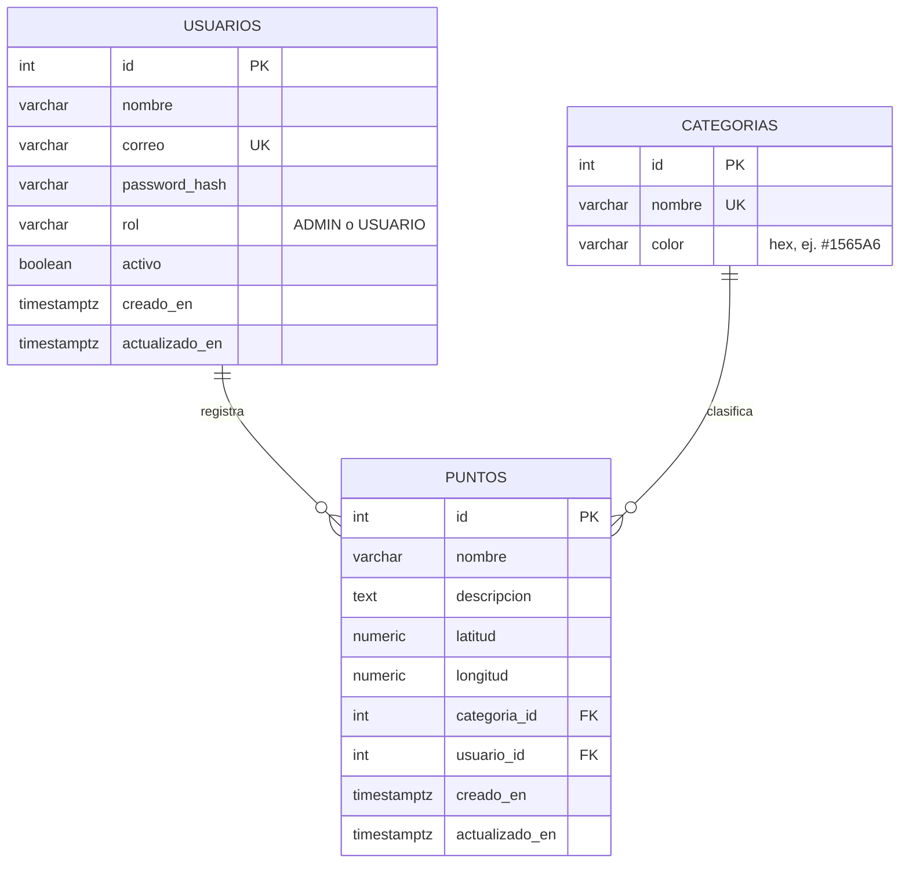
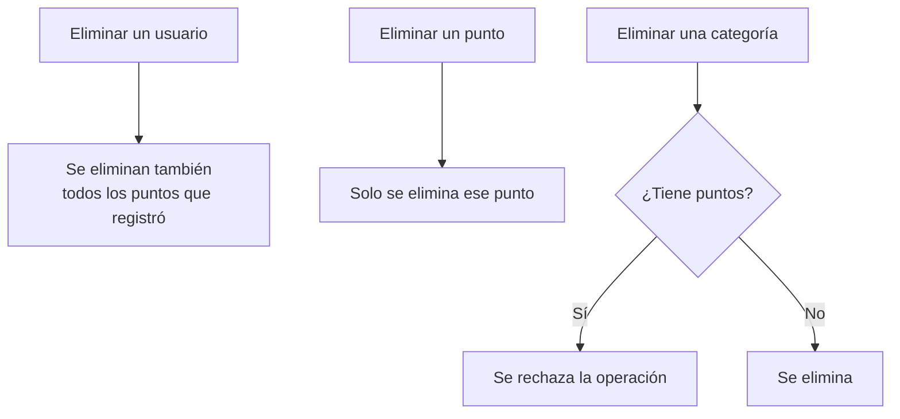
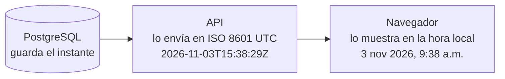

# Base de datos

Motor: PostgreSQL. Los scripts están en `database/`: `schema.sql` crea las tablas y `seed.sql` carga los datos de ejemplo.

Este diseño parte de la estructura recomendada en el enunciado y le hace algunos ajustes. Cada cambio está explicado en [decisiones.md](decisiones.md).

## Diagrama entidad-relación



Un usuario registra muchos puntos y una categoría agrupa muchos puntos. Cada punto pertenece a una sola categoría y a un solo usuario.

## Tablas

### usuarios

| Campo | Tipo | Notas |
|---|---|---|
| id | SERIAL | Llave primaria |
| nombre | VARCHAR(100) NOT NULL | |
| correo | VARCHAR(120) NOT NULL | Se usa para iniciar sesión. Único sin distinguir mayúsculas |
| password_hash | VARCHAR(255) NOT NULL | Contraseña cifrada con bcrypt |
| rol | VARCHAR(20) NOT NULL | Solo `ADMIN` o `USUARIO` |
| activo | BOOLEAN NOT NULL DEFAULT TRUE | Inactivo = no puede entrar |
| creado_en | TIMESTAMPTZ NOT NULL DEFAULT NOW() | Guarda el instante exacto; ver [Fechas y zona horaria](#fechas-y-zona-horaria) |
| actualizado_en | TIMESTAMPTZ NOT NULL DEFAULT NOW() | Se actualiza en cada edición |

### categorias

| Campo | Tipo | Notas |
|---|---|---|
| id | SERIAL | Llave primaria |
| nombre | VARCHAR(50) NOT NULL UNIQUE | Oficina, Almacén, Cliente, Punto de interés |
| color | VARCHAR(7) NOT NULL | Color del punto en el mapa. Debe tener formato `#RRGGBB` |

### puntos

| Campo | Tipo | Notas |
|---|---|---|
| id | SERIAL | Llave primaria |
| nombre | VARCHAR(100) NOT NULL | |
| descripcion | TEXT | Opcional |
| latitud | NUMERIC(9,6) NOT NULL | Entre -90 y 90 |
| longitud | NUMERIC(9,6) NOT NULL | Entre -180 y 180 |
| categoria_id | INT NOT NULL | Llave foránea a `categorias.id` |
| usuario_id | INT NOT NULL | Llave foránea a `usuarios.id` (quién lo registró) |
| creado_en | TIMESTAMPTZ NOT NULL DEFAULT NOW() | Guarda el instante exacto; ver [Fechas y zona horaria](#fechas-y-zona-horaria) |
| actualizado_en | TIMESTAMPTZ NOT NULL DEFAULT NOW() | Se actualiza en cada edición |

## Reglas de integridad

| Regla | Dónde se aplica |
|---|---|
| Rol limitado a `ADMIN` o `USUARIO` | `CHECK` en `usuarios.rol` |
| Latitud entre -90 y 90, longitud entre -180 y 180 | `CHECK` en `puntos` |
| Color con formato `#RRGGBB` | `CHECK` en `categorias.color` |
| Correo único sin distinguir mayúsculas | Índice único sobre `LOWER(correo)` |
| Eliminar un usuario elimina sus puntos | `ON DELETE CASCADE` en `puntos.usuario_id` |
| No se puede eliminar una categoría con puntos | `ON DELETE RESTRICT` en `puntos.categoria_id` |

Las validaciones también se hacen en la API y en los formularios. La base de datos es la última barrera: protege los datos aunque alguien la use sin pasar por la aplicación.

## Qué pasa al eliminar



La API ya impide que un administrador se elimine a sí mismo, y la interfaz avisa antes de borrar un usuario que tiene puntos.

## Fechas y zona horaria

Las columnas `creado_en` y `actualizado_en` son `TIMESTAMPTZ` (*timestamp with time zone*). PostgreSQL guarda el **instante exacto**, sin depender de en qué zona horaria esté configurado el servidor. El dato recorre tres tramos y en cada uno se trata así:



Por eso la misma fecha se ve distinta según el lugar: 15:38 UTC son las 9:38 a.m. en la Ciudad de México y las 4:38 p.m. en Madrid, y las dos son correctas.

Antes de este cambio las columnas eran `TIMESTAMP` (sin zona). La base, en Docker, anotaba la hora UTC sin decirlo, y el servidor de Node, al leerla, la tomaba como hora local. En México eso sumaba seis horas de más. El detalle y las alternativas descartadas están en [decisiones.md](decisiones.md) (D-27).

### Bases creadas antes del cambio

Una base nueva ya nace correcta porque `schema.sql` está actualizado. Una base que ya existía se convierte con la migración, que conserva todos los datos:

```bash
docker exec -i geopuntos-db psql -U geopuntos -d geopuntos < database/migraciones/2026-11-03-fechas-con-zona-horaria.sql
```

Se ejecuta **una sola vez**. Interpreta las fechas antiguas como UTC, que es lo que estaban guardando. La alternativa es borrar el volumen (`docker compose down -v` y `docker compose up -d`), pero eso elimina los datos.

## Índices

| Índice | Para qué |
|---|---|
| `usuarios (LOWER(correo))`, único | Login y control de correos repetidos |
| `puntos (categoria_id)` | Filtro por categoría y el JOIN con `categorias` |
| `puntos (usuario_id)` | El JOIN con `usuarios` y el borrado en cascada |
| `puntos (LOWER(nombre))` | Búsqueda por nombre |

## Datos semilla

- 1 administrador y 2 usuarios, con contraseña cifrada con bcrypt.
- 4 categorías: Oficina `#1565A6`, Almacén `#17845A`, Cliente `#0B3954` y Punto de interés `#D97706`.
- Al menos 6 puntos de ejemplo.

El detalle de cada registro y los usuarios de prueba están en [datos-semilla.md](datos-semilla.md).

## Consulta principal

El listado de puntos une las tres tablas:

```sql
SELECT p.id, p.nombre, p.descripcion, p.latitud, p.longitud, p.creado_en,
       c.id AS categoria_id, c.nombre AS categoria, c.color,
       u.id AS usuario_id, u.nombre AS registrado_por
FROM puntos p
JOIN categorias c ON c.id = p.categoria_id
JOIN usuarios u   ON u.id = p.usuario_id
ORDER BY p.creado_en DESC;
```
