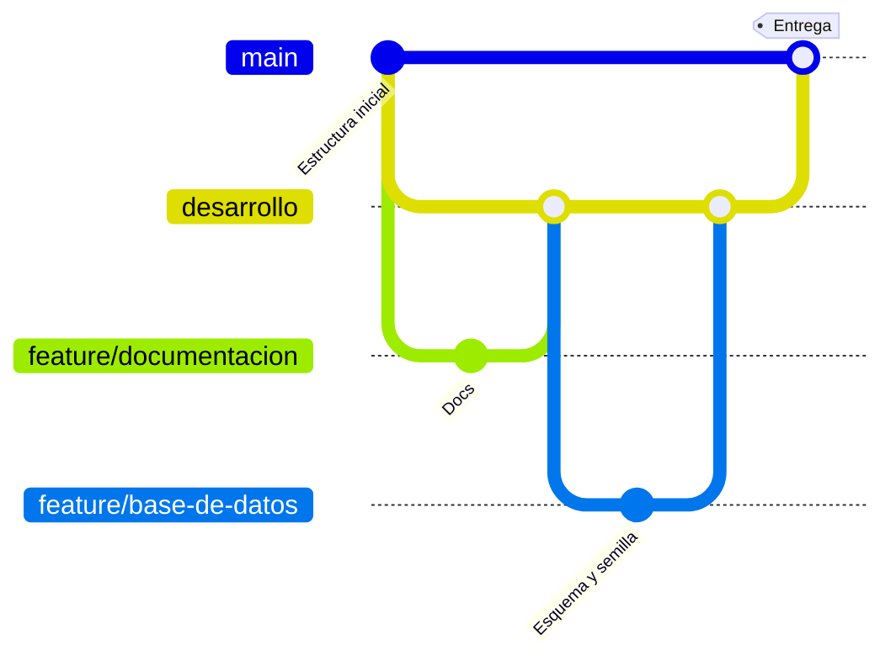

# Decisiones de diseño

Aquí se anotan los cambios respecto a lo recomendado en el enunciado y las decisiones que no son obvias. Cada entrada dice qué se decidió, por qué y qué otra opción había.

## D-01. Flujo de ramas y pull requests

**Fecha:** 2026-11-02

**Decisión:** `main` solo recibe el pull request final. `desarrollo` es la rama de integración. Cada bloque de trabajo sale de `desarrollo` en una rama corta (`feature/...`) y vuelve con su propio pull request.

**Por qué:** cada pull request se revisa por separado, el historial queda ordenado y `main` siempre tiene código que funciona.

**Alternativa descartada:** trabajar todo en `desarrollo` y hacer un solo pull request al final. Es más rápido, pero el cambio final sería enorme y difícil de revisar.

## D-02. Al eliminar un usuario se eliminan sus puntos

**Fecha:** 2026-11-02

**Decisión:** `puntos.usuario_id` usa `ON DELETE CASCADE`. Cuando se elimina un usuario, desaparecen también todos los puntos que registró.

**Por qué:** `usuario_id` es obligatorio, así que un punto no puede quedar sin dueño. Se eligió que los datos de un usuario eliminado se vayan con él.

**Alternativas descartadas:**
- `ON DELETE RESTRICT`: obliga a borrar o reasignar los puntos antes de eliminar al usuario. Es más seguro, pero más incómodo.
- `ON DELETE SET NULL`: conserva los puntos, pero exige que `usuario_id` acepte nulos y se pierde quién los registró.

**Consecuencias:**
- La acción es destructiva e irreversible, por eso la confirmación debe avisar cuántos puntos se van a eliminar.
- Para no perder información, la alternativa es desactivar al usuario (`activo = false`) en lugar de eliminarlo.

## D-03. Restricciones en la base de datos

**Fecha:** 2026-11-02

**Decisión:** además de validar en la API y en los formularios, se agregan `CHECK` en la base de datos:
- `usuarios.rol` solo acepta `ADMIN` o `USUARIO`.
- `puntos.latitud` entre -90 y 90, y `puntos.longitud` entre -180 y 180.
- `categorias.color` con formato `#RRGGBB`.

**Por qué:** el enunciado solo las menciona como notas. Si se validan solo en la API, un dato incorrecto puede entrar por un script o por una consulta directa. Con `CHECK` la base se protege sola.

## D-04. Correo único sin distinguir mayúsculas

**Fecha:** 2026-11-02

**Decisión:** índice único sobre `LOWER(correo)` en lugar de `UNIQUE` sobre la columna. La API también normaliza el correo a minúsculas antes de guardar o buscar.

**Por qué:** con un `UNIQUE` simple, `Ana@empresa.com` y `ana@empresa.com` serían dos usuarios distintos, lo que confunde al iniciar sesión.

## D-05. Columna `actualizado_en`

**Fecha:** 2026-11-02

**Decisión:** `usuarios` y `puntos` incluyen `actualizado_en`, que se actualiza en cada edición.

**Por qué:** permite saber cuándo se modificó un registro por última vez. El costo es una columna más por tabla.

## D-06. Índices de apoyo

**Fecha:** 2026-11-02

**Decisión:** índices sobre `puntos.categoria_id`, `puntos.usuario_id` y `LOWER(puntos.nombre)`.

**Por qué:** PostgreSQL no crea índices automáticamente en las llaves foráneas. Estas columnas se usan en los filtros y en los `JOIN`. Con pocos datos no se nota, pero es una buena práctica.

## D-07. Una categoría con puntos no se puede eliminar

**Fecha:** 2026-11-02

**Decisión:** `puntos.categoria_id` usa `ON DELETE RESTRICT`.

**Por qué:** las categorías definen el color de los puntos en el mapa. Si se pudieran borrar con puntos asociados, esos puntos quedarían sin categoría o se perderían por accidente.

## D-08. Despliegue

**Fecha:** 2026-11-02

**Decisión:** el desarrollo se hace en local con PostgreSQL en Docker. Para publicarlo se propone Neon (base de datos), Render (API) y Vercel o Netlify (frontend).

**Por qué:** los tres tienen plan gratuito y despliegan solos desde GitHub. Para que funcione hay que:
- Configurar las variables de entorno en cada servicio.
- Permitir en el CORS de la API la URL del frontend publicado.
- Activar SSL en la conexión a Neon.

**Estado:** pendiente. Se hace al final y solo cuenta como punto extra.
