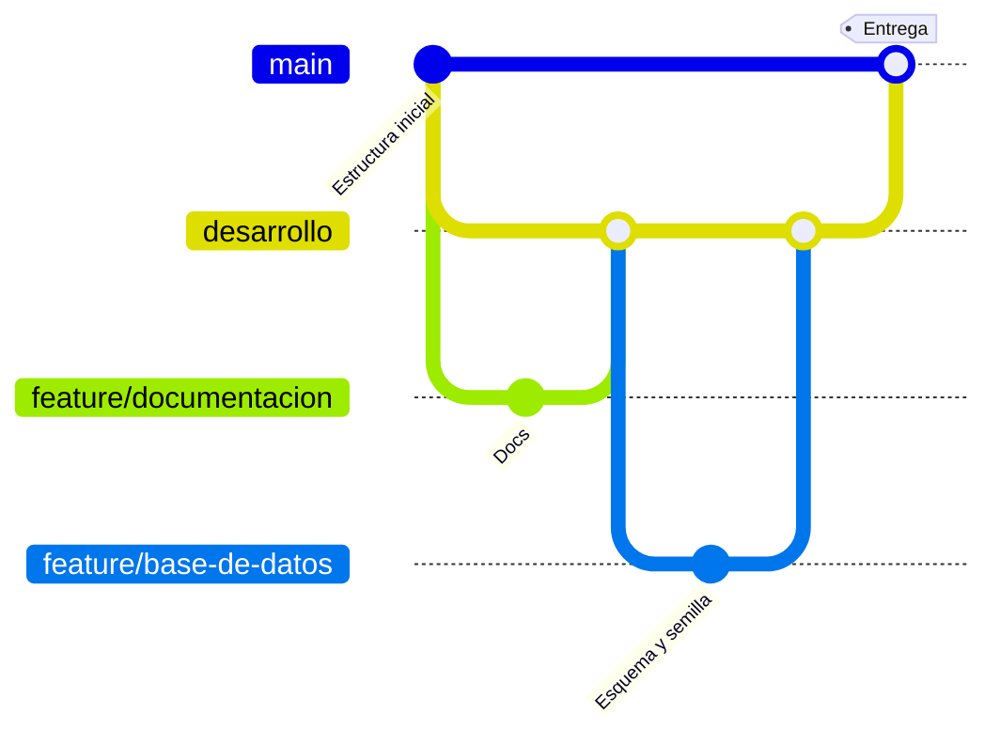

# Decisiones de diseño

Aquí se anotan los cambios respecto a lo recomendado en el enunciado y las decisiones que no son obvias. Cada entrada dice qué se decidió, por qué y qué otra opción había.

## D-01. Flujo de ramas y pull requests

**Fecha:** 2026-11-02

**Decisión:** `main` solo recibe el pull request final. `desarrollo` es la rama de integración. Cada bloque de trabajo sale de `desarrollo` en una rama corta (`feature/...`) y vuelve con su propio pull request.

**Por qué:** cada pull request se revisa por separado, el historial queda ordenado y `main` siempre tiene código que funciona.

**Alternativa descartada:** trabajar todo en `desarrollo` y hacer un solo pull request al final. Es más rápido, pero el cambio final sería enorme y difícil de revisar.

## D-02. Al eliminar un usuario se eliminan sus puntos

**Fecha:** 2026-11-02

**Decisión:** `puntos.usuario_id` usa `ON DELETE CASCADE`. Cuando se elimina un usuario, desaparecen también todos los puntos que registró.

**Por qué:** `usuario_id` es obligatorio, así que un punto no puede quedar sin dueño. Se eligió que los datos de un usuario eliminado se vayan con él.

**Alternativas descartadas:**
- `ON DELETE RESTRICT`: obliga a borrar o reasignar los puntos antes de eliminar al usuario. Es más seguro, pero más incómodo.
- `ON DELETE SET NULL`: conserva los puntos, pero exige que `usuario_id` acepte nulos y se pierde quién los registró.

**Consecuencias:**
- La acción es destructiva e irreversible, por eso la confirmación debe avisar cuántos puntos se van a eliminar.
- Para no perder información, la alternativa es desactivar al usuario (`activo = false`) en lugar de eliminarlo.

## D-03. Restricciones en la base de datos

**Fecha:** 2026-11-02

**Decisión:** además de validar en la API y en los formularios, se agregan `CHECK` en la base de datos:
- `usuarios.rol` solo acepta `ADMIN` o `USUARIO`.
- `puntos.latitud` entre -90 y 90, y `puntos.longitud` entre -180 y 180.
- `categorias.color` con formato `#RRGGBB`.

**Por qué:** el enunciado solo las menciona como notas. Si se validan solo en la API, un dato incorrecto puede entrar por un script o por una consulta directa. Con `CHECK` la base se protege sola.

## D-04. Correo único sin distinguir mayúsculas

**Fecha:** 2026-11-02

**Decisión:** índice único sobre `LOWER(correo)` en lugar de `UNIQUE` sobre la columna. La API también normaliza el correo a minúsculas antes de guardar o buscar.

**Por qué:** con un `UNIQUE` simple, `Ana@empresa.com` y `ana@empresa.com` serían dos usuarios distintos, lo que confunde al iniciar sesión.

## D-05. Columna `actualizado_en`

**Fecha:** 2026-11-02

**Decisión:** `usuarios` y `puntos` incluyen `actualizado_en`, que se actualiza en cada edición.

**Por qué:** permite saber cuándo se modificó un registro por última vez. El costo es una columna más por tabla.

## D-06. Índices de apoyo

**Fecha:** 2026-11-02

**Decisión:** índices sobre `puntos.categoria_id`, `puntos.usuario_id` y `LOWER(puntos.nombre)`.

**Por qué:** PostgreSQL no crea índices automáticamente en las llaves foráneas. Estas columnas se usan en los filtros y en los `JOIN`. Con pocos datos no se nota, pero es una buena práctica.

## D-07. Una categoría con puntos no se puede eliminar

**Fecha:** 2026-11-02

**Decisión:** `puntos.categoria_id` usa `ON DELETE RESTRICT`.

**Por qué:** las categorías definen el color de los puntos en el mapa. Si se pudieran borrar con puntos asociados, esos puntos quedarían sin categoría o se perderían por accidente.

## D-08. Despliegue

**Fecha:** 2026-11-02

**Decisión:** el desarrollo se hace en local con PostgreSQL en Docker. Para publicarlo se propone Neon (base de datos), Render (API) y Vercel o Netlify (frontend).

**Por qué:** los tres tienen plan gratuito y despliegan solos desde GitHub. Para que funcione hay que:
- Configurar las variables de entorno en cada servicio.
- Permitir en el CORS de la API la URL del frontend publicado.
- Activar SSL en la conexión a Neon.

**Estado:** pendiente. Se hace al final y solo cuenta como punto extra.

## D-09. bcryptjs en lugar de bcrypt

**Fecha:** 2026-11-02

**Decisión:** las contraseñas se cifran con `bcryptjs`, la implementación de bcrypt escrita en JavaScript.

**Por qué:** el paquete `bcrypt` incluye código nativo que a veces falla al instalar según el sistema o la versión de Node, y también al desplegar. `bcryptjs` produce el mismo formato de hash, así que un hash generado con uno lo verifica el otro. Es algo más lento, algo que aquí no importa.

**Alternativa descartada:** `bcrypt` nativo. Es más rápido, pero añade el riesgo de que el proyecto no instale en otra máquina.

## D-10. La autenticación consulta al usuario en cada petición

**Fecha:** 2026-11-02

**Decisión:** además de verificar la firma del token, el middleware `autenticar` busca al usuario en la base. El rol que se usa es el de la base de datos, no el que viaja dentro del token.

**Por qué:** un JWT es válido hasta que vence. Sin esta consulta, un usuario desactivado o eliminado seguiría entrando hasta 8 horas, y uno al que le quitan el rol de administrador conservaría sus permisos. Con la consulta, el cambio aplica en la siguiente petición.

**Costo:** una consulta por llave primaria en cada petición. Para este volumen es despreciable.

**Alternativa descartada:** confiar solo en el token. Es más rápido, pero deja esos huecos de seguridad.

## D-11. Mensajes del login que no revelan información

**Fecha:** 2026-11-02

**Decisión:**
- Correo inexistente y contraseña incorrecta dan el mismo mensaje y el mismo código (401).
- El aviso de cuenta inactiva solo aparece si la contraseña es correcta.
- Si el correo no existe, igualmente se compara la contraseña contra un hash de relleno.

**Por qué:** los mensajes distintos y las diferencias de tiempo permiten averiguar qué correos están registrados y cuáles cuentas están inactivas. El enunciado pide un mensaje para un usuario inactivo, y así se cumple sin filtrar datos a quien no conoce la contraseña.

## D-12. Puertos locales: API en 3001 y base en 5433

**Fecha:** 2026-11-02

**Decisión:** la API usa el puerto 3001 y el contenedor de PostgreSQL se publica en el 5433. Ambos se cambian en `.env`.

**Por qué:** en el entorno de desarrollo el 3000 ya lo usaba otra aplicación y el 5432 lo ocupaba un PostgreSQL instalado en Windows. En ese caso la API se conectaba al servidor equivocado y fallaba con un error de contraseña, difícil de diagnosticar. Dentro del contenedor la base sigue en el 5432; solo cambia el puerto publicado.

## D-13. Validación con zod y variables de entorno comprobadas al arrancar

**Fecha:** 2026-11-02

**Decisión:** los cuerpos de las peticiones y las variables de `.env` se validan con `zod`. Si falta o es inválida una variable, la API no arranca y dice cuál.

**Por qué:** un esquema declarativo evita repetir `if` a mano y deja los tipos de TypeScript inferidos de la misma definición, sin `any`. Fallar al arrancar es mejor que descubrir una llave del JWT vacía cuando alguien intenta entrar.

## D-14. Un administrador no puede quitarse el acceso a sí mismo

**Fecha:** 2026-11-02

**Decisión:** la API responde 400 si un administrador intenta desactivar su propia cuenta, quitarse el rol de administrador o eliminarse. El enunciado solo pide impedir lo último.

**Por qué:** cualquiera de las tres acciones puede dejar al sistema sin ningún administrador, y entonces nadie podría gestionar usuarios sin entrar a la base de datos. Como siempre queda al menos quien hace la petición, nunca se llega a cero administradores.

## D-15. Respuestas con objetos anidados y nombres en camelCase

**Fecha:** 2026-11-02

**Decisión:** la API devuelve `categoria` y `registradoPor` como objetos dentro del punto, y los nombres en camelCase (`creadoEn`, `categoriaId`) en lugar de los de la base (`creado_en`, `categoria_id`). Las coordenadas se convierten a número.

**Por qué:** así encajan directo con las interfaces de TypeScript del frontend y no hay que pedir las categorías por separado para pintar cada punto. PostgreSQL devuelve las columnas `NUMERIC` como texto, y convertirlas en la API evita que el mapa reciba `"19.43"` en lugar de `19.43`.

## D-16. Contraseña vacía al editar significa "no cambiar"

**Fecha:** 2026-11-02

**Decisión:** en la edición de un usuario, una contraseña vacía se trata igual que si no viniera.

**Por qué:** el formulario del enunciado deja la contraseña opcional al editar y, al dejarla en blanco, el campo viaja como cadena vacía. Sin esta regla, el usuario recibiría un error de "mínimo 8 caracteres" aunque no quisiera cambiarla.

## D-17. Angular 21 en lugar de la última versión

**Fecha:** 2026-11-02

**Decisión:** el frontend usa Angular 21.

**Por qué:** la versión más reciente del CLI (22) exige Node 22.22.3 o superior y el equipo de desarrollo tiene Node 22.19. Angular 21 funciona con esa versión y trae todo lo que pide el enunciado: componentes standalone, signals, `@if` / `@for` y una aplicación sin zone.js.

**Alternativa descartada:** actualizar Node. Habría obligado a quien revise el proyecto a tener una versión muy reciente para poder correrlo.

## D-18. Sesión en localStorage, validada contra la API al abrir

**Fecha:** 2026-11-02

**Decisión:** el token y los datos básicos del usuario se guardan en `localStorage`. Al abrir o recargar la app se consulta `/api/auth/perfil` para comprobar que el token sigue siendo válido y refrescar el rol.

**Por qué:** el enunciado pide que el token se guarde y que la sesión no se pierda al recargar. Validarlo contra la API evita mostrar pantallas de alguien a quien ya desactivaron o eliminaron. Si el almacenamiento no está disponible (modo privado, bloqueado), la app sigue funcionando y la sesión dura mientras la pestaña esté abierta.

**Alternativa descartada:** una cookie `HttpOnly`, que protege mejor frente a XSS, pero exige cambiar la API para emitirla y configurar CORS con credenciales. Queda como mejora posible.

## D-19. El interceptor envía el token solo a la API

**Fecha:** 2026-11-02

**Decisión:** `authInterceptor` agrega el encabezado `Authorization` únicamente si la URL empieza con `environment.apiUrl`.

**Por qué:** si más adelante la aplicación hace peticiones a un servicio de terceros, el token no debe viajar con ellas.

## D-20. Búsqueda y filtro en el cliente en la pantalla del mapa

**Fecha:** 2026-11-02

**Decisión:** el mapa pide todos los puntos una sola vez y filtra en el navegador con un `computed`. La API también admite `?q=` y `?categoriaId=`, y esos filtros se dejan para el listado de la pantalla Puntos.

**Por qué:** la lista y el mapa deben reaccionar a la vez a cada tecla, y filtrar en memoria es instantáneo y evita una petición por cada letra. Con cientos de puntos sigue siendo inmediato. Con miles habría que filtrar en el servidor.

## D-21. OpenLayers sin envoltorios, con el ciclo de vida de Angular

**Fecha:** 2026-11-02

**Decisión:** el mapa se maneja directamente con la API de OpenLayers (sin una librería que lo envuelva para Angular). Se crea en `ngAfterViewInit` y se libera en `ngOnDestroy`. Los datos viven en signals, y un `effect` sincroniza la capa de puntos y la ventana cuando cambian los filtros o la selección.

**Por qué:** el enunciado pide aplicar OpenLayers directamente, y así queda claro quién crea y destruye cada pieza. Sin liberar el mapa al salir, quedarían escuchadores y el contenedor colgados cada vez que se visita la pantalla.

## D-22. Capa satelital de Esri y selector de capas con ol-ext

**Fecha:** 2026-11-03

**Decisión:** además de OpenStreetMap, el mapa ofrece una capa satelital con las imágenes de Esri (`World_Imagery`). El cambio entre "Calles" y "Satélite" se hace con el `LayerSwitcher` de `ol-ext`, como sugiere el enunciado como punto extra. Las capas de puntos y de ubicación se excluyen del selector.

**Por qué:** las imágenes de Esri no necesitan llave ni cuenta y permiten un uso ligero a cambio de mostrar su atribución, que aparece en la esquina del mapa. Para una demo es suficiente. En producción habría que revisar sus condiciones de uso o contratar un proveedor.

**Detalle técnico:** `ol-ext` no trae tipos de TypeScript, así que se declara solo lo que se usa en `src/types/ol-ext.d.ts`, sin `any`.

## D-23. Ubicación del usuario con la API del navegador

**Fecha:** 2026-11-03

**Decisión:** el botón "Ir a mi ubicación" usa `navigator.geolocation`. El navegador pregunta al usuario si lo permite; si acepta, el mapa vuela hasta ahí y marca un punto con su círculo de precisión. Si rechaza el permiso, la posición no está disponible o se agota el tiempo (10 s), se muestra un aviso con el motivo.

**Por qué:** es la forma estándar y no necesita ningún servicio externo. La ubicación solo se usa para dibujar la marca en el mapa: no se guarda ni se envía a la API.

**Limitación:** el navegador solo permite la geolocalización en páginas seguras (HTTPS o `localhost`). Al desplegar, el frontend debe servirse por HTTPS.

## D-24. Modal de confirmación con el elemento `<dialog>`

**Fecha:** 2026-11-03

**Decisión:** el modal de confirmación usa la etiqueta nativa `<dialog>` abierta con `showModal()`, en lugar de armarlo con un `div` y capas de CSS o de sumar una librería de componentes. El servicio devuelve una promesa, así que quien lo usa escribe `if (await confirmar(...))`.

**Por qué:** el navegador ya resuelve lo difícil de un modal: el fondo oscuro, bloquear el resto de la página, atrapar el foco dentro de la ventana y cerrar con Esc. Una promesa evita pasar funciones de retorno entre componentes. El foco inicial queda en "Cancelar", para que pulsar Enter sin pensar no elimine nada.

**Detalle:** Esc y un clic en el fondo se tratan como "Cancelar", de modo que la promesa nunca queda sin resolver.

## D-25. Avisos temporales en lugar de alertas del navegador

**Fecha:** 2026-11-03

**Decisión:** los mensajes de éxito y de error se muestran como avisos en la esquina (`ToastService`), no con `alert()` ni dentro de cada pantalla. Los errores duran más (7 s) que los de éxito (4 s). Los de error usan `role="alert"` y los de éxito `role="status"`, para que los lectores de pantalla los anuncien.

**Por qué:** un solo lugar y un mismo aspecto para todos los avisos, y no interrumpen como `alert()`. Los errores de validación de un campo siguen mostrándose debajo del propio campo, que es donde la persona los necesita.

## D-26. Coordenadas del clic en el mapa

**Fecha:** 2026-11-03

**Decisión:** al hacer clic en el mapa del formulario, la latitud y la longitud se redondean a 6 decimales y la longitud se normaliza al rango de -180 a 180.

**Por qué:** la columna de la base de datos es `NUMERIC(9,6)`, así que más decimales no se conservarían. Si el mapa se arrastra más allá del antimeridiano, OpenLayers devuelve longitudes como 190 o -250, y la API las rechazaría por estar fuera de rango. Normalizarlas evita un error sin sentido para quien solo hizo clic.

## D-27. Fechas con zona horaria (`TIMESTAMPTZ`)

**Fecha:** 2026-11-03

**Problema:** un punto creado a las 9:38 a.m. en la Ciudad de México aparecía como creado a las 3:38 p.m., seis horas después. Pasaba con todas las fechas: puntos y usuarios, en la tabla y en cualquier otro lugar que las muestre.

**Causa:** tres detalles que juntos producían el error.
1. Las columnas eran `TIMESTAMP` (sin zona horaria), como sugiere el enunciado. Guardan el reloj, pero no a qué zona pertenece.
2. El contenedor de PostgreSQL trabaja en UTC, así que `NOW()` escribía `15:38:29`, que es la hora de Greenwich. Estaba bien, pero sin ninguna marca que lo dijera.
3. El servidor de Node (`pg`) lee un `TIMESTAMP` sin zona como si fuera la **hora local de la máquina donde corre**. En México lo tomaba como las 15:38 locales, que equivalen a las 21:38 UTC, y eso era lo que viajaba al navegador.

**Decisión:** las cuatro columnas de fecha (`creado_en` y `actualizado_en` en `usuarios` y `puntos`) pasan a `TIMESTAMPTZ`. PostgreSQL guarda el instante exacto, la API lo envía en ISO 8601 con zona UTC (`...Z`) y el navegador lo muestra en la hora local de quien lo mira. No hizo falta cambiar el código de la API ni el del frontend.

**Migración:** `database/migraciones/2026-11-03-fechas-con-zona-horaria.sql` convierte una base existente conservando sus datos. Interpreta los valores antiguos como UTC, que es lo que contenían. Está en una transacción: o se aplica completa o no cambia nada.

**Alternativas descartadas:**
- *Decirle a `pg` que lea los `TIMESTAMP` como UTC* (un `setTypeParser` en el código). Es una línea y no toca la base, pero esconde el problema: depende de que el servidor de la base esté en UTC, y cualquier otra herramienta que lea la tabla volvería a interpretar mal la hora.
- *Arrancar Node con `TZ=UTC`.* Haría coincidir las dos horas locales, pero obliga a recordarlo en cada entorno, incluido el despliegue.
- *Convertir en el navegador restando seis horas.* Rompería a quien use la aplicación desde otra zona horaria, y en el horario de verano de otros países.

**Verificado:**
- Un registro existente creado a las 15:38 UTC pasó de mostrarse como "3:38 p.m." a "9:38 a.m.".
- Los datos de la semilla se ven a las 11:20 a.m. del día en que se cargaron.
- Un registro nuevo creado a las 09:59 en México salió con `15:59Z` desde la API.
- `schema.sql` y `seed.sql` se ejecutaron en una base vacía sin errores.

**Para el despliegue:** una base nueva (por ejemplo, en Neon) se crea con `schema.sql` ya corregido, así que no necesita la migración.
