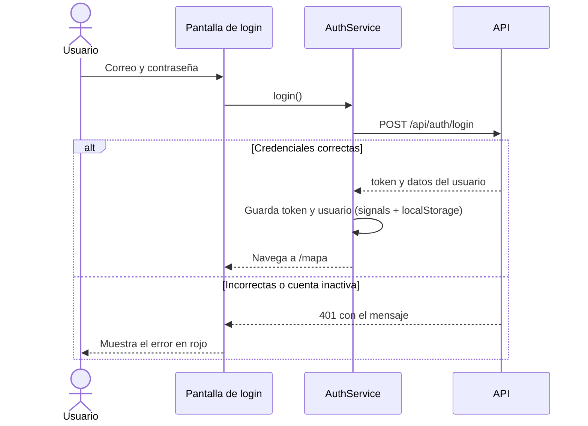
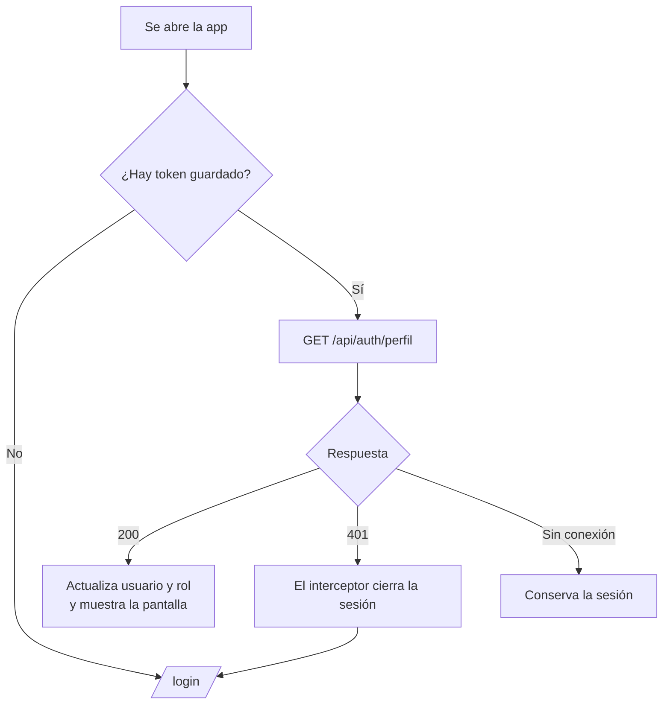
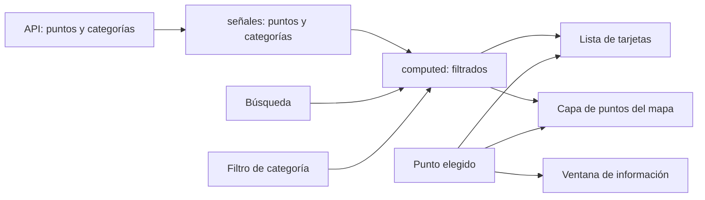

# Frontend

Aplicación Angular 21 con componentes standalone, signals y el control de flujo `@if` / `@for`. TypeScript en modo `strict`, sin `any`.

## Estructura

```
frontend/src/
├── environments/        apiUrl por ambiente (desarrollo y producción)
└── app/
    ├── models/          interfaces: Usuario, Punto, Categoria y los datos de login
    ├── services/        AuthService (sesión) y, más adelante, los servicios de datos
    ├── interceptors/    authInterceptor: agrega el token a cada petición
    ├── guards/          authGuard, sinSesionGuard y adminGuard
    ├── pages/           una carpeta por pantalla (login, mapa, ...)
    ├── components/      piezas reutilizables entre pantallas
    └── utils/           utilidades, como convertir errores de la API en texto
```

## Rutas y guards

| Ruta | Guard | Qué pasa |
|---|---|---|
| `/login` | `sinSesionGuard` | Si ya hay sesión, redirige a `/mapa` |
| `/mapa` y `/puntos` | `authGuard` (en la ruta padre) | Sin sesión, redirige a `/login` |
| `/usuarios` | `authGuard` y `adminGuard` | Un usuario normal que la escriba es enviado a `/mapa` |
| `/` y cualquier ruta desconocida | | Van a `/mapa`; si no hay sesión, el guard las manda a `/login` |

`/mapa`, `/puntos` y `/usuarios` son rutas hijas de una ruta padre sin ruta propia que carga el componente `Shell`. Así el guard de sesión se declara una sola vez y todas comparten el menú lateral.

Las pantallas se cargan de forma diferida (`loadComponent`), así que el código de cada una se descarga solo cuando se visita.

## Marco con menú lateral (`Shell`)

- Menú fijo a la izquierda con Mapa, Puntos y Usuarios. **Usuarios solo aparece para administradores** (`@if (auth.esAdmin())`), y además la ruta está protegida por `adminGuard`, porque ocultar un enlace no basta.
- Abajo muestra a quien tiene la sesión (iniciales, nombre y rol) y el botón "Cerrar sesión".
- La opción activa se resalta con `routerLinkActive`.
- En pantallas estrechas el menú pasa arriba, en una sola franja.
- Por ahora `/puntos` y `/usuarios` muestran una pantalla provisional ("Próximamente") hasta que se construyan.

## Flujo de la sesión



## Qué pasa al abrir o recargar la app



El interceptor aplica a cada petición:
1. Agrega `Authorization: Bearer <token>` solo si la URL es de la API, nunca a terceros.
2. Si la API responde 401 (token vencido, usuario desactivado o eliminado) y no es el propio login, cierra la sesión y manda a `/login`.

## Pantalla de login

- Formulario reactivo con correo y contraseña. El correo debe ser válido y ambos son obligatorios.
- Los errores salen debajo de cada campo y el botón queda desactivado mientras haya errores.
- Botón para mostrar u ocultar la contraseña.
- Si la API rechaza las credenciales, o la cuenta está inactiva, se muestra el mensaje en rojo.
- Panel de marca a la izquierda con un mapa decorativo hecho solo con CSS. En pantallas estrechas se apila sobre el formulario.

## Pantalla del mapa (`/mapa`)

A la izquierda, un panel con buscador por nombre, filtro por categoría, contador y una tarjeta por punto. A la derecha, el mapa de OpenLayers.

| Elemento | Detalle |
|---|---|
| Capas base | OpenStreetMap (calles) y Esri World Imagery (satélite), con selector `LayerSwitcher` de ol-ext |
| Botones | Zoom, pantalla completa, "Ver todos los puntos" y "Ir a mi ubicación" (marca azul con círculo de precisión) |
| Capa de puntos | Vectorial; cada punto se pinta con el color de su categoría mediante una función de estilo |
| Punto elegido | Más grande, con borde blanco grueso y un halo azul |
| Controles | Zoom, barra de escala (`ScaleLine`) y leyenda de categorías |
| Ventana de información | `Overlay` con nombre, categoría, descripción, coordenadas y quién lo registró |

**Lista y mapa conectados (RF-09).** Elegir una tarjeta centra el mapa con animación, hace zoom (sin alejar si ya estabas más cerca), resalta el punto y abre su ventana. Hacer clic en un punto del mapa hace lo mismo en sentido contrario y marca su tarjeta. La búsqueda y el filtro por categoría actúan sobre la lista y el mapa a la vez, porque ambos leen la misma señal `filtrados`.



**Ciclo de vida del mapa.** Se crea en `ngAfterViewInit`, cuando ya existe el contenedor en la página, y se libera en `ngOnDestroy` (`setTarget(undefined)`) al salir de la pantalla. La primera vez que llegan los datos, la vista se ajusta para que se vean todos los puntos.

La pantalla muestra un estado de carga, un mensaje de error con botón "Reintentar" si la API falla, y "No hay puntos con esos filtros" cuando no hay resultados.

## Cómo correrlo

```bash
cd frontend
npm install
npm start
```

Queda en `http://localhost:4200`. Necesita la API en el puerto 3001. Para cambiar la dirección de la API se edita `src/environments/environment.development.ts`.
