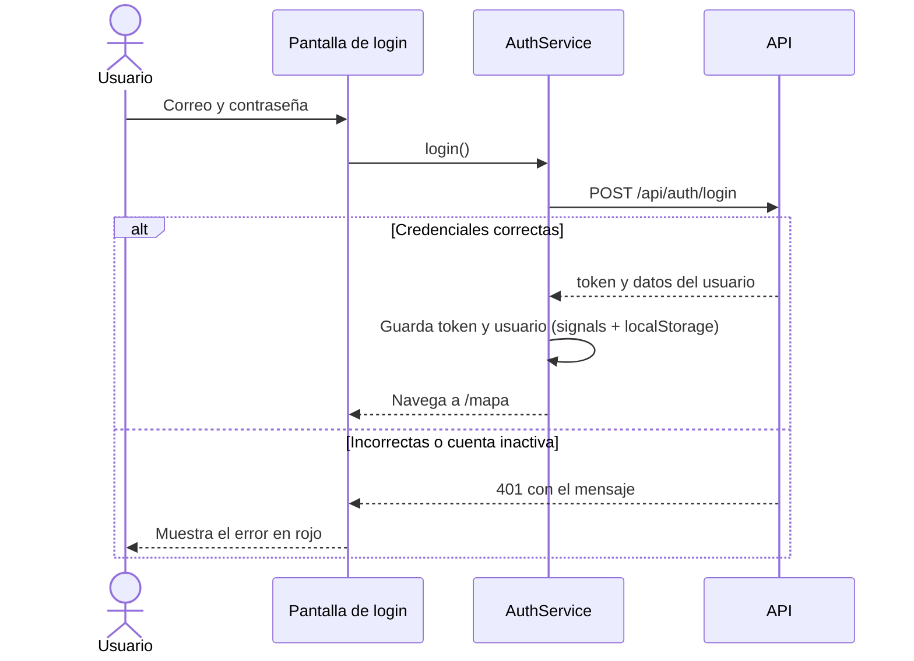
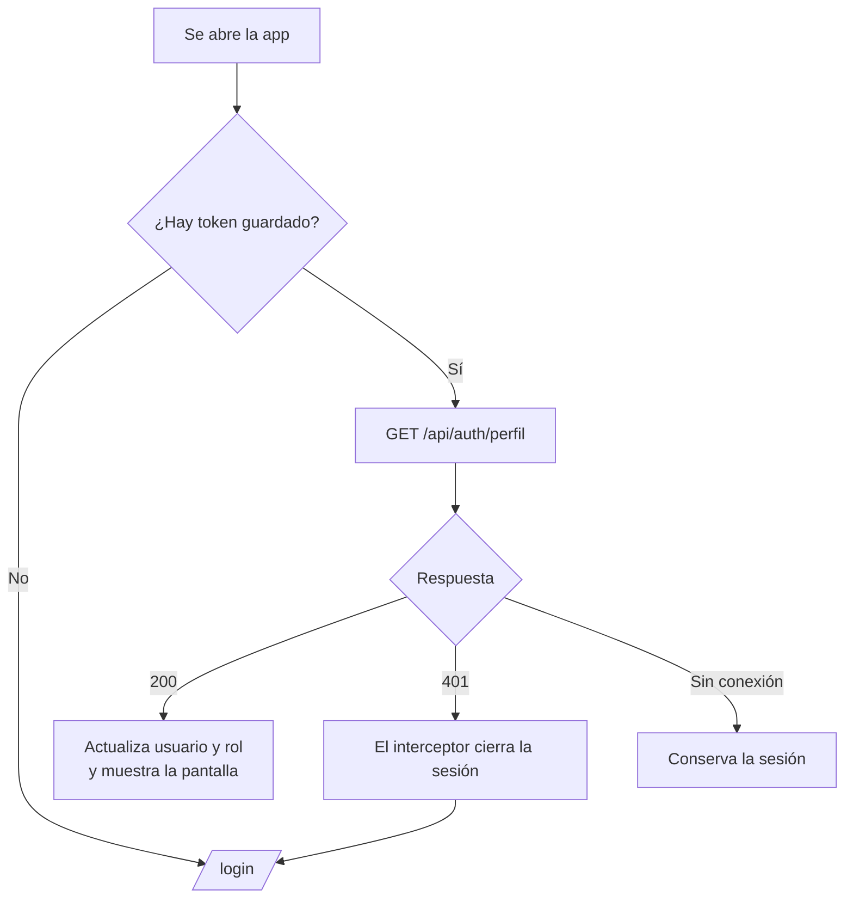

# Frontend

Aplicación Angular 21 con componentes standalone, signals y el control de flujo `@if` / `@for`. TypeScript en modo `strict`, sin `any`.

## Estructura

```
frontend/src/
├── environments/        apiUrl por ambiente (desarrollo y producción)
└── app/
    ├── models/          interfaces: Usuario, Punto, Categoria y los datos de login
    ├── services/        AuthService (sesión) y, más adelante, los servicios de datos
    ├── interceptors/    authInterceptor: agrega el token a cada petición
    ├── guards/          authGuard, sinSesionGuard y adminGuard
    ├── pages/           una carpeta por pantalla (login, mapa, ...)
    ├── components/      piezas reutilizables entre pantallas
    └── utils/           utilidades, como convertir errores de la API en texto
```

## Rutas y guards

| Ruta | Guard | Qué pasa |
|---|---|---|
| `/login` | `sinSesionGuard` | Si ya hay sesión, redirige a `/mapa` |
| `/mapa` | `authGuard` | Sin sesión, redirige a `/login` |
| `/` y cualquier ruta desconocida | | Van a `/mapa`; si no hay sesión, el guard las manda a `/login` |

Las pantallas se cargan de forma diferida (`loadComponent`), así que el código de cada una se descarga solo cuando se visita.

`adminGuard` queda listo para la ruta `/usuarios`: un usuario normal que la escriba es enviado a `/mapa`.

## Flujo de la sesión



## Qué pasa al abrir o recargar la app



El interceptor aplica a cada petición:
1. Agrega `Authorization: Bearer <token>` solo si la URL es de la API, nunca a terceros.
2. Si la API responde 401 (token vencido, usuario desactivado o eliminado) y no es el propio login, cierra la sesión y manda a `/login`.

## Pantalla de login

- Formulario reactivo con correo y contraseña. El correo debe ser válido y ambos son obligatorios.
- Los errores salen debajo de cada campo y el botón queda desactivado mientras haya errores.
- Botón para mostrar u ocultar la contraseña.
- Si la API rechaza las credenciales, o la cuenta está inactiva, se muestra el mensaje en rojo.
- Panel de marca a la izquierda con un mapa decorativo hecho solo con CSS. En pantallas estrechas se apila sobre el formulario.

## Cómo correrlo

```bash
cd frontend
npm install
npm start
```

Queda en `http://localhost:4200`. Necesita la API en el puerto 3001. Para cambiar la dirección de la API se edita `src/environments/environment.development.ts`.
