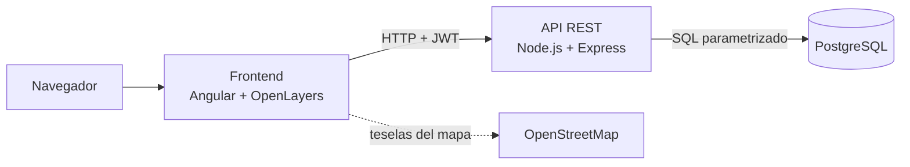
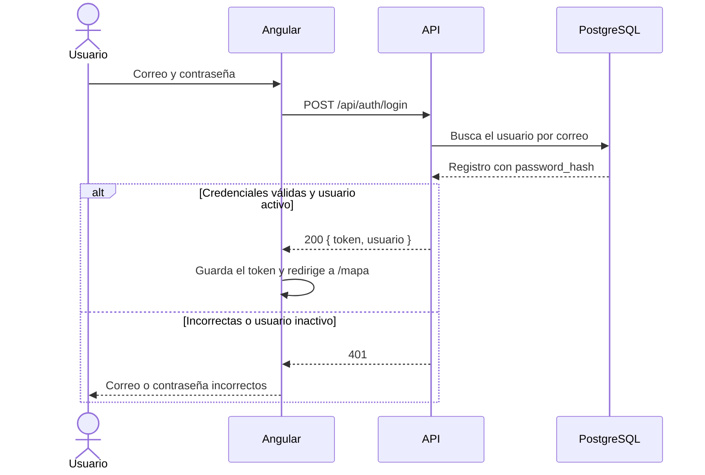
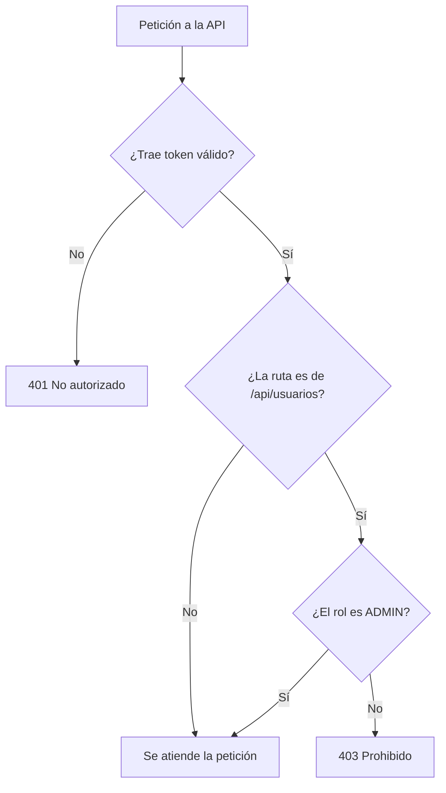

# Requerimientos

## Alcance

GeoPuntos permite registrar puntos geográficos (oficinas, almacenes, clientes y puntos de interés) con su latitud y longitud, y verlos en un mapa. Solo entran usuarios registrados. Los administradores, además, gestionan a los usuarios del sistema.

## Arquitectura general

El frontend nunca habla con la base de datos. Todo pasa por la API, que valida el token, el rol y los datos antes de consultar.

## Módulos

| Módulo | Qué hace | Quién lo usa |
|---|---|---|
| Login | Entrada con correo y contraseña. Sin sesión no se ve nada. | Todos |
| Mapa | Muestra los puntos con color por categoría y una lista lateral conectada al mapa. | Todos |
| Puntos | Tabla con búsqueda y filtro. Alta, edición (con clic en el mapa) y eliminación. | Todos |
| Usuarios | Tabla de usuarios. Alta, edición, cambio de rol, activar o desactivar y eliminación. | Solo administradores |

## Requerimientos funcionales

| Código | Requerimiento | Descripción |
|---|---|---|
| RF-01 | Iniciar sesión | Con correo y contraseña. Si son correctos, la API devuelve un token JWT y se entra al mapa. Si no, se muestra "Correo o contraseña incorrectos". Un usuario inactivo no puede entrar. |
| RF-02 | Rutas protegidas | Sin sesión, cualquier ruta redirige a `/login`. El token se envía en cada petición mediante un interceptor. Hay un botón "Cerrar sesión" en el menú. |
| RF-03 | Roles | El administrador ve todo, incluido Usuarios. El usuario normal ve Mapa y Puntos; la opción Usuarios no aparece y la API responde 403. |
| RF-04 | Gestión de usuarios | Listar con búsqueda y filtro por rol. Crear, editar, cambiar rol, activar o desactivar y eliminar (con confirmación). El correo no se puede repetir. |
| RF-05 | Mapa de puntos | Todos los puntos, cada categoría con su color, leyenda, zoom y barra de escala. Al hacer clic en un punto se abre una ventana con su información. |
| RF-06 | Listado de puntos | Tabla con nombre, categoría, coordenadas, quién lo registró y fecha. Búsqueda por nombre y filtro por categoría. |
| RF-07 | Registrar y editar puntos | Formulario con nombre, categoría, descripción, latitud y longitud. Al hacer clic en el mapa del formulario se coloca el punto y se llenan las coordenadas. |
| RF-08 | Eliminar puntos | Pide confirmación. Al aceptar desaparece de la tabla y del mapa. |
| RF-09 | Lista y mapa conectados | En la pantalla Mapa, al elegir un punto de la lista el mapa se centra y lo resalta. El filtro por categoría afecta a la lista y al mapa a la vez. |
| RF-10 | Validaciones | Nombre obligatorio (3 a 100 caracteres), categoría obligatoria, latitud entre -90 y 90, longitud entre -180 y 180, correo válido y contraseña de mínimo 8 caracteres. Los errores se muestran debajo de cada campo y Guardar queda desactivado mientras haya errores. |

## Roles y permisos

| Acción | Administrador | Usuario |
|---|:---:|:---:|
| Ver mapa y listado de puntos | Sí | Sí |
| Crear, editar y eliminar puntos | Sí | Sí |
| Ver y gestionar usuarios | Sí | No |

## Requerimientos no funcionales

- **Tipado:** TypeScript en modo `strict` y sin `any`.
- **Angular moderno:** componentes standalone, signals y el control de flujo `@if` / `@for`.
- **API REST:** rutas en plural, respuestas JSON y códigos HTTP correctos (200, 201, 204, 400, 401, 403, 404, 409).
- **Seguridad:** contraseñas con bcrypt que la API nunca devuelve. Credenciales y llave del JWT en `.env`, fuera del repositorio. Consultas SQL parametrizadas.
- **Orden:** el backend se organiza en rutas, controladores, servicios y middlewares. El frontend en páginas, componentes, servicios y guards.
- **Documentación:** README con los pasos para instalar y correr todo.

## Flujo de inicio de sesión

## Flujo de una petición protegida

